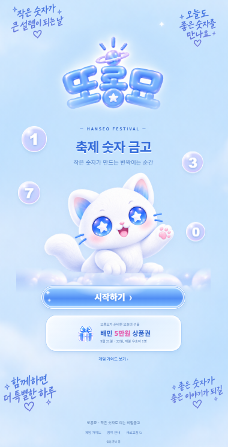
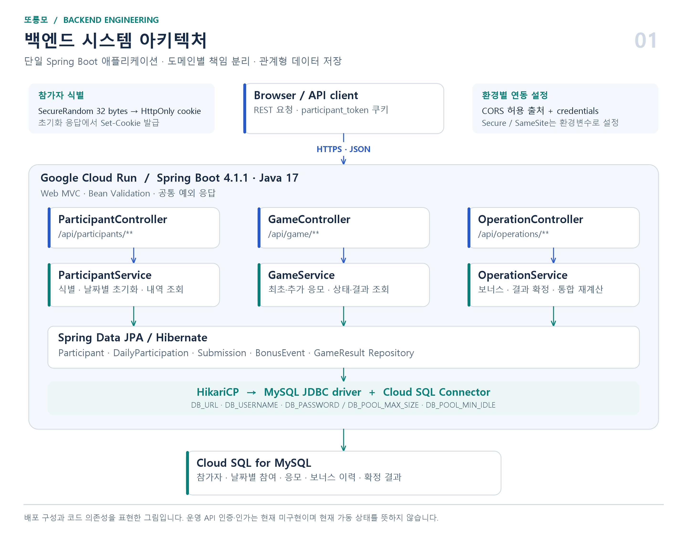
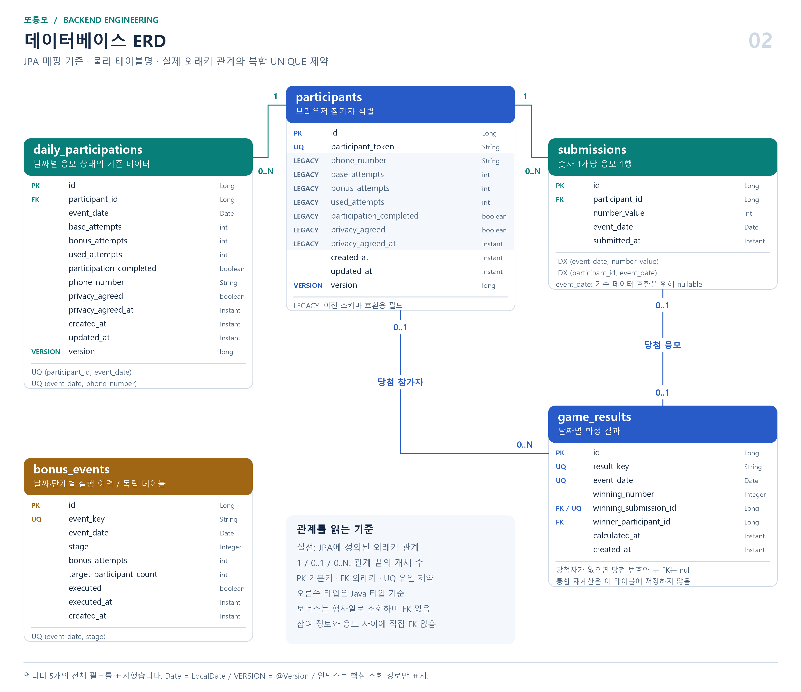
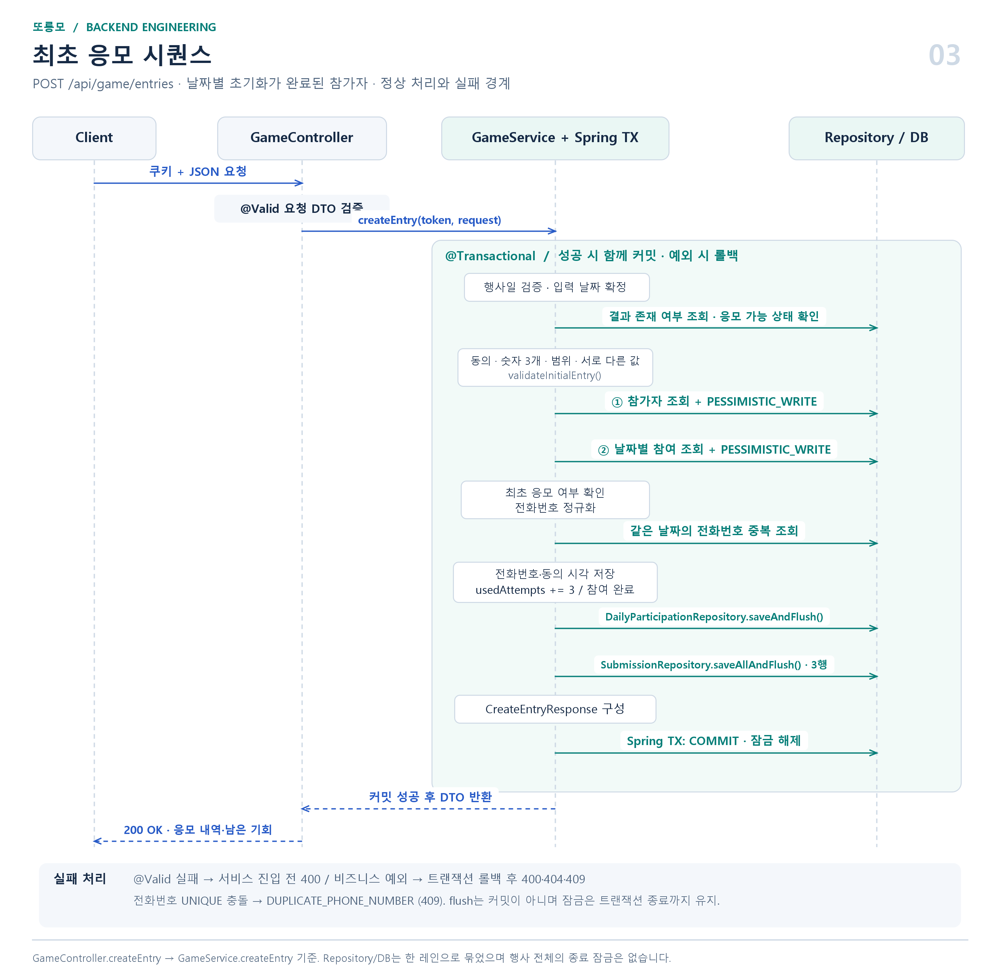

# 또롱모

### 대학 축제 부스에서 운영한 숫자 응모 서비스 백엔드

> 부스의 QR 코드를 스캔해 접속하고, 가장 작은 고유 숫자로 경품에 응모하는 축제 참여형 서비스입니다.

**또롱모**는 2026년 2학기 대학 축제에서 **멋쟁이사자처럼 14기 동아리 부스를 운영하며 사용한 숫자 응모 서비스**입니다. 부스 방문자는 현장에 비치한 QR 코드로 서비스에 접속해 숫자를 제출했고, 당첨자에게는 부스에서 상품을 지급했습니다. 이 저장소는 해당 서비스의 참가자 식별부터 응모 기록 관리와 당첨자 선정까지 담당하는 Spring Boot 백엔드입니다.

참가자는 `0000`부터 `9999` 사이에서 서로 다른 숫자 3개를 선택합니다. 집계 대상 응모에서 **정확히 한 번 제출된 숫자 중 가장 작은 숫자**가 당첨 번호가 됩니다. 날짜별로 참여 상태를 관리하고, 운영자가 보너스 단계를 열면 최대 4번의 추가 응모 기회를 제공합니다.

백엔드에서는 현장에서 이어지는 응모와 운영 요청에 맞춰 **날짜별 데이터 분리**, **트랜잭션과 잠금을 통한 응모 처리**, **SQL 집계 기반 당첨자 선정**, **기존 결과를 보존하는 통합 재계산**을 구현했습니다.

| 항목 | 내용 |
| --- | --- |
| 서비스명 | 또롱모 |
| 운영 맥락 | 2026년 2학기 대학 축제 · 멋쟁이사자처럼 14기 동아리 부스 |
| 참여 방식 | 부스 QR 코드로 접속 → 숫자 응모 → 당첨 결과 확인 → 부스에서 상품 지급 |
| 백엔드 개발 범위 | REST API, 데이터 모델, 응모·집계 로직, 통합 테스트, 클라우드 배포 구성 |
| 주요 기술 | Java 17, Spring Boot, Spring Data JPA, MySQL |
| 배포 환경 | Google Cloud Run, Cloud SQL for MySQL |
| 저장소 | [ParkChanWoo0321/UNIQUE](https://github.com/ParkChanWoo0321/UNIQUE) |

## 축제 현장의 참여 흐름

방문자는 부스의 QR 코드를 스캔해 아래 서비스 화면으로 접속했습니다. 별도 회원가입 없이 참여할 수 있도록 쿠키로 참가자를 식별하고, 행사일별로 숫자와 전화번호, 개인정보 동의를 받아 응모를 처리했습니다. 운영자는 보너스 단계와 결과 확정 API로 이벤트를 진행하고, 당첨자에게 상품을 지급했습니다.



*부스 방문자가 QR 코드로 접속한 또롱모 서비스의 시작 화면*

이 운영 흐름에서 백엔드는 참가자별 남은 기회와 응모 내역을 일관되게 관리하고, 날짜별 결과와 전체 행사일을 합친 결과를 각각 계산하는 역할을 맡았습니다.

## 핵심 구현

| 해결해야 할 문제 | 구현 방식 |
| --- | --- |
| 회원가입 없이 참가자를 식별해야 함 | 난수 토큰과 HttpOnly 쿠키를 사용하고, 날짜별 참여 상태를 별도 관리 |
| 같은 날짜의 중복 응모와 기회 초과 사용을 제한해야 함 | 트랜잭션, 비관적 쓰기 잠금, 전화번호 복합 UNIQUE 제약 적용 |
| 보너스 지급 이후 참여한 사람에게도 같은 기회를 제공해야 함 | 날짜별 보너스 실행 이력을 저장하고 초기화 시 열린 단계 수 반영 |
| 날짜별 결과와 행사 전체 결과를 함께 제공해야 함 | 날짜별 결과 확정과 전체 행사일 읽기 전용 재계산을 분리 |

## 기술 스택

| 구분 | 기술 및 사용 목적 |
| --- | --- |
| 언어 | Java 17 — 서비스 로직과 record 기반 요청·응답 DTO |
| 프레임워크 | Spring Boot 4.1.1, Spring Web MVC — REST API와 애플리케이션 구성 |
| 데이터 접근 | Spring Data JPA, Hibernate — 엔티티 매핑, 트랜잭션, 잠금 |
| 데이터베이스 | MySQL — 참여·응모 데이터와 운영 이력 저장 |
| 요청 검증 | Jakarta Bean Validation — 숫자 범위, 전화번호 형식, 개인정보 동의 검증 |
| API 문서 | Springdoc OpenAPI 3.1.1, Swagger UI — API 명세 제공 |
| 테스트 | JUnit Jupiter, Spring Boot Test, MockMvc, H2 MySQL 모드 |
| 빌드 | Gradle Wrapper 9.7.1 |
| 인프라 | Google Cloud Run, Cloud SQL for MySQL, Cloud SQL Connector |
| 상태 확인 | Spring Boot Actuator — health 및 liveness/readiness 상태 제공 |

## 백엔드 구조

도메인을 `participant`, `game`, `operation`으로 나누고, 각 도메인 안에 Controller·Service·Repository·Entity·DTO를 배치했습니다. 공통 날짜 검증, 예외 처리, 쿠키 연동 설정은 별도 구성 요소로 분리했습니다.



[확대 가능한 SVG 원본](docs/diagrams/architecture.svg) · 단일 서버 안의 도메인 계층과 Cloud SQL 연결 구조를 나타냅니다.

| 패키지 | 책임 |
| --- | --- |
| `participant` | 참가자 토큰 발급, 쿠키 생성, 날짜별 참여 초기화, 내 응모 내역 조회 |
| `game` | 최초 응모, 추가 응모, 상태 조회, 날짜별 당첨 결과 조회 |
| `operation` | 보너스 단계 개방, 날짜별 결과 확정, 전체 행사일 통합 재계산 |
| `common` | 행사일 검증, CORS, OpenAPI, 예외 응답, 번호·전화번호 변환 |

`spring.jpa.open-in-view=false`로 설정하고, 서비스의 트랜잭션 안에서 필요한 연관 데이터에 접근해 응답 DTO를 구성합니다. 조회 기능에는 `@Transactional(readOnly = true)`, 응모와 운영 데이터 변경에는 `@Transactional`을 적용했습니다.

## 데이터 설계

하나의 참가자가 여러 행사일에 참여할 수 있으므로 **브라우저의 참가자 식별 정보**와 **날짜별 응모 상태**를 분리했습니다. 날짜별 전화번호, 개인정보 동의 시각, 기본·추가·사용 기회는 `daily_participations`에서 관리합니다.



[확대 가능한 SVG 원본](docs/diagrams/erd.svg) · 엔티티 5개의 전체 필드와 실제 외래키 관계를 표시했습니다. 회색 필드는 이전 스키마 호환용이며, `bonus_events`에는 다른 테이블을 참조하는 외래키가 없습니다.

| 테이블 | 저장 내용 | 주요 제약 및 인덱스 |
| --- | --- | --- |
| `participants` | 참가자 식별 토큰 | `participant_token` UNIQUE |
| `daily_participations` | 날짜별 기회, 참여 완료 여부, 전화번호, 개인정보 동의 | `(participant_id, event_date)` UNIQUE, `(event_date, phone_number)` UNIQUE |
| `submissions` | 참가자별 응모 숫자, 행사일, 제출 시각 | `(event_date, number_value)`, `(participant_id, event_date)` 인덱스 |
| `bonus_events` | 날짜별 보너스 단계와 실행 이력 | `(event_date, stage)` UNIQUE, `event_key` UNIQUE |
| `game_results` | 날짜별 당첨 번호, 당첨 응모, 당첨 참가자 | `event_date`, `result_key`, `winning_submission_id` 각각 UNIQUE |

`daily_participations`와 `submissions`는 각각 `participants`를 참조합니다. `game_results`는 당첨 응모와 참가자를 참조하고, `bonus_events`는 행사일과 단계로 운영 이력을 구분합니다.

전화번호는 하이픈을 제거한 뒤 저장합니다. 같은 날짜에는 동일한 전화번호로 다시 응모할 수 없고, 다른 날짜의 참여는 허용합니다. 숫자는 DB에 정수로 저장하고 응답 시 `"0037"`과 같은 네 자리 문자열로 변환합니다.

기존 스키마와의 호환을 위해 `participants`에 남아 있는 참여 횟수·연락처 필드와 구분하여, 현재 날짜별 참여 로직은 `daily_participations`를 기준으로 동작합니다.

관련 코드: [DailyParticipation](src/main/java/hsu/unique/participant/entity/DailyParticipation.java) · [Submission](src/main/java/hsu/unique/game/entity/Submission.java) · [GameResult](src/main/java/hsu/unique/game/entity/GameResult.java)

## 주요 설계와 문제 해결

### 1. 비회원 참가자 식별과 날짜별 상태 분리

축제 현장에서 별도의 회원가입 없이 참여할 수 있도록 `SecureRandom`으로 생성한 32바이트 난수를 URL-safe Base64 토큰으로 변환했습니다. 서버는 이 토큰을 `participant_token`이라는 HttpOnly 쿠키에 담아 발급하고, 이후 요청에서 참가자를 조회합니다.

유효한 쿠키로 다시 초기화하면 기존 참가자를 사용합니다. 다른 행사일을 선택하면 같은 참가자 아래에 해당 날짜의 참여 정보를 생성하므로, 첫째 날의 응모가 둘째 날의 기본 기회를 소모하지 않습니다.

쿠키의 `Secure`, `SameSite`, 만료 기간과 CORS 허용 출처를 환경변수로 분리했습니다. CORS는 명시한 출처에 대해 credentials를 허용합니다. 토큰은 브라우저의 참가자를 식별하며, 전화번호 소유권 인증 기능은 포함하지 않습니다.

관련 코드: [ParticipantTokenGenerator](src/main/java/hsu/unique/participant/service/ParticipantTokenGenerator.java) · [ParticipantCookieManager](src/main/java/hsu/unique/participant/service/ParticipantCookieManager.java) · [ParticipantService](src/main/java/hsu/unique/participant/service/ParticipantService.java)

### 2. 최초 응모를 하나의 트랜잭션으로 처리

최초 응모에는 숫자 3개, 전화번호, 개인정보 동의가 함께 필요합니다. 일부 데이터만 저장되면 기회는 사용했지만 응모가 누락되는 등 상태가 어긋날 수 있어, 다음 처리를 하나의 트랜잭션으로 묶었습니다.

1. 운영하는 행사일인지, 응모가 가능한 상태인지 확인합니다.
2. 개인정보 동의와 서로 다른 숫자 3개, `0~9999` 범위를 검증합니다.
3. 참가자와 해당 날짜의 참여 행을 `PESSIMISTIC_WRITE`로 조회합니다.
4. 최초 응모 완료 여부와 같은 날짜의 전화번호 중복을 확인합니다.
5. 전화번호·동의 시각·사용 기회·참여 완료 상태를 반영합니다.
6. 응모 숫자 3개를 저장하고 결과를 반환합니다.

같은 참가자의 요청이 겹칠 때는 잠금을 획득한 트랜잭션이 상태를 확인하고 변경하도록 했습니다. 서로 다른 참가자가 같은 전화번호로 요청하는 경우에는 애플리케이션의 사전 조회에 더해 DB의 `(event_date, phone_number)` UNIQUE 제약으로 중복 저장을 제한합니다.

추가 응모도 같은 잠금 순서로 처리합니다. 최초 응모 완료, 남은 기회, 당일 본인이 이미 제출한 숫자인지를 확인한 후 응모 저장과 기회 1회 차감을 함께 수행합니다.



[확대 가능한 SVG 원본](docs/diagrams/entry-sequence.svg) · `GameService.createEntry()`의 실제 호출 순서입니다. 참가자 행과 날짜별 참여 행을 순서대로 잠그고, 참여 상태와 응모 3행을 함께 커밋합니다. `flush` 시점에는 트랜잭션이 끝나지 않습니다.

관련 코드: [GameService](src/main/java/hsu/unique/game/service/GameService.java) · [ParticipantRepository](src/main/java/hsu/unique/participant/repository/ParticipantRepository.java) · [DailyParticipationRepository](src/main/java/hsu/unique/participant/repository/DailyParticipationRepository.java)

### 3. 보너스 단계 이력으로 늦은 참가자의 기회 보정

보너스 지급 시점에 이미 참여한 사람만 갱신하면, 이후 참가자는 같은 행사일에도 더 적은 기회를 받게 됩니다. 이를 처리하기 위해 보너스 실행을 날짜별 단계 이력으로 저장했습니다.

운영 API를 호출하면 해당 날짜의 다음 단계를 생성하고, 기존 날짜별 참여 행을 잠근 뒤 보너스 기회를 1회씩 추가합니다. 이후 새로 초기화하는 참가자는 열린 보너스 단계 수를 읽어 초기 추가 기회로 반영합니다.

예를 들어 보너스가 2단계까지 열린 후 참여하면 기본 3회와 추가 2회를 받아 총 5회의 기회를 갖습니다. 보너스는 최대 4단계이며, 단계 이력 저장과 기존 참가자의 기회 증가는 하나의 트랜잭션으로 처리합니다.

`(event_date, stage)` UNIQUE 제약은 동일 단계의 중복 저장을 제한합니다. 별개의 정상 호출은 다음 단계를 여는 동작이므로, 보너스 API 자체가 재시도에 대해 멱등인 것은 아닙니다.

관련 코드: [OperationService.executeBonus](src/main/java/hsu/unique/operation/service/OperationService.java) · [BonusEvent](src/main/java/hsu/unique/operation/entity/BonusEvent.java) · [ParticipantService.initialize](src/main/java/hsu/unique/participant/service/ParticipantService.java)

### 4. SQL 집계로 가장 작은 고유 숫자 선정

당첨 조건은 숫자의 크기와 전체 제출 횟수로 결정됩니다. 응모 전체를 애플리케이션 메모리로 가져오는 대신 DB에서 숫자별 제출 횟수를 집계하고, 조건을 만족하는 최솟값을 조회합니다.

```sql
SELECT number_value
FROM submissions
WHERE event_date = :eventDate
GROUP BY number_value
HAVING COUNT(*) = 1
ORDER BY number_value ASC
LIMIT 1;
```

예를 들어 A가 `[1, 2, 8]`, B가 `[1, 2, 3]`을 제출하면 `1`과 `2`는 중복으로 제외되고 `3`이 당첨됩니다. 모든 숫자가 중복이거나 응모가 없으면 당첨자 없이 결과를 반환합니다.

날짜별 종료 API는 계산 결과를 `game_results`에 저장합니다. 이미 결과가 있는 날짜의 재확정은 거절하며, 이후 해당 날짜에 들어오는 응모도 `GAME_CLOSED`로 거절합니다.

조회 조건에 맞춰 `(event_date, number_value)` 복합 인덱스를 정의했습니다. 실행 계획 분석이나 부하 측정에 따른 성능 개선 수치는 별도로 산출하지 않았습니다.

관련 코드: [SubmissionRepository.findSmallestUniqueNumber](src/main/java/hsu/unique/game/repository/SubmissionRepository.java) · [OperationService.finishGame](src/main/java/hsu/unique/operation/service/OperationService.java)

### 5. 날짜별 결과를 보존하면서 행사 전체 당첨자 재계산

여러 행사일의 응모를 합쳐 총 1명을 선정하려면 날짜별 당첨자만 비교해서는 안 됩니다. 어느 하루에는 고유했던 숫자가 다른 날에도 제출되었을 수 있기 때문입니다.

통합 재계산에서는 `EVENT_DATES`에 포함된 전체 응모를 대상으로 숫자별 횟수를 다시 집계합니다. 같은 참가자가 다른 날 같은 숫자를 제출한 경우도 2회 제출로 계산해 제외합니다.

| 구분 | 날짜별 결과 확정 | 전체 행사일 통합 재계산 |
| --- | --- | --- |
| API | `POST /api/operations/finish` | `POST /api/operations/recalculate` |
| 집계 범위 | 선택한 행사일 | 설정된 전체 행사일 |
| 결과 저장 | `game_results`에 저장 | 저장 없이 계산 결과 반환 |
| 반복 호출 | 이미 확정되었으면 오류 | 호출 시점의 응모로 다시 계산 |
| 응모 마감 | 이후 해당 날짜의 응모 차단 | 마감 상태 변경 없음 |
| 연락처 조회 | 선택한 날짜의 참여 정보 | 당첨 응모가 발생한 날짜의 참여 정보 |

통합 재계산은 `@Transactional(readOnly = true)`로 구현해 기존 응모와 날짜별 결과를 보존합니다. 날짜별 결과 조회 API에도 영향을 주지 않으며, 행사일 밖의 데이터와 날짜가 없는 기존 응모는 집계 대상에서 제외합니다.

> **통합 당첨자 재계산 검증 사진 넣는곳**
>
> 테스트용 이틀 응모 데이터, 날짜를 가로질러 중복된 숫자의 제외 과정, 최종 당첨 번호 응답을 함께 보여주는 화면. 연락처는 마스킹

관련 코드: [SubmissionRepository.findOverallWinningSubmission](src/main/java/hsu/unique/game/repository/SubmissionRepository.java) · [OperationService.recalculateOverallResult](src/main/java/hsu/unique/operation/service/OperationService.java) · [OverallGameResultResponse](src/main/java/hsu/unique/operation/dto/OverallGameResultResponse.java)

## API 설계

조회·초기화·보너스·종료 API의 `eventDate` 쿼리 파라미터를 생략하면 설정된 첫 행사일을 사용합니다. 최초·추가 응모는 JSON 본문에 `eventDate`를 필수로 전달하고, 통합 재계산은 날짜나 본문을 받지 않습니다.

| Method | Endpoint | 기능 |
| --- | --- | --- |
| `POST` | `/api/participants/initialize` | 참가자 식별 및 날짜별 참여 초기화 |
| `GET` | `/api/participants/me` | 내 응모 번호와 남은 기회 조회 |
| `GET` | `/api/game/status` | 참여 완료 인원, 보너스 단계, 진행 상태 조회 |
| `POST` | `/api/game/entries` | 숫자 3개·전화번호·개인정보 동의로 최초 응모 |
| `POST` | `/api/game/submissions` | 추가 기회로 숫자 1개 제출 |
| `GET` | `/api/game/result` | 날짜별 당첨 번호와 본인 당첨 여부 조회 |
| `POST` | `/api/operations/bonus` | 선택 날짜의 다음 보너스 단계 개방 |
| `POST` | `/api/operations/finish` | 선택 날짜의 결과 계산 및 확정 |
| `POST` | `/api/operations/recalculate` | 전체 행사일의 당첨자 1명 재계산 |

참가자용 결과 응답에는 당첨 번호와 본인의 당첨 여부를 제공하고, 연락처는 포함하지 않습니다. 종료·재계산 응답에는 당첨자의 전화번호가 포함됩니다. 현재 `/api/operations/**`에 별도 인증·인가가 없어 접근 제어는 후속 개선 항목입니다.

### 요청과 오류 응답

최초 응모 요청 예시입니다. 전화번호는 설명용 가상 값입니다.

```json
{
  "eventDate": "2026-09-21",
  "numbers": [0, 37, 9999],
  "phoneNumber": "010-0000-0000",
  "privacyAgreed": true
}
```

`@RestControllerAdvice`에서 비즈니스 예외와 입력 검증 오류를 공통 `code`, `message` 형식으로 변환합니다. 클라이언트는 메시지 문자열을 비교하지 않고 오류 코드에 따라 화면을 처리할 수 있습니다.

```json
{
  "code": "DUPLICATE_PHONE_NUMBER",
  "message": "해당 날짜에 이미 응모한 전화번호입니다."
}
```

잘못된 입력은 `400`, 참가자 식별 실패는 `404`, 중복 응모·기회 소진·종료된 게임 등 상태 충돌은 `409`로 구분합니다. 예상하지 못한 예외는 서버에 로그를 남기고 공통 `500` 응답으로 처리합니다.

> **Swagger API 명세 사진 넣는곳**
>
> 참가자·게임·운영 API 목록과 최초 응모의 요청·응답 스키마가 보이는 Swagger UI 화면

관련 코드: [CreateEntryRequest](src/main/java/hsu/unique/game/dto/CreateEntryRequest.java) · [ErrorCode](src/main/java/hsu/unique/common/exception/ErrorCode.java) · [GlobalExceptionHandler](src/main/java/hsu/unique/common/exception/GlobalExceptionHandler.java)

## 테스트와 검증

`@SpringBootTest`와 MockMvc로 HTTP 요청부터 서비스·Repository·DB까지 연결한 통합 테스트를 작성했습니다. 테스트 전용 H2 DB를 MySQL 모드로 실행하고, 각 테스트 전에 데이터를 정리해 시나리오 간 영향을 줄였습니다.

**검증 결과: 통합 테스트 14개 통과, 실패·오류·건너뜀 0개, Gradle 빌드 성공.** 2026년 10월 21일 Java 17 환경에서 `test build --rerun-tasks --no-daemon`으로 재실행한 결과입니다.

| 검증 영역 | 주요 시나리오 |
| --- | --- |
| 참가자 초기화 | 쿠키 발급 속성, 동일 쿠키 재사용, 날짜별 독립 참여 상태 |
| 최초 응모 | 숫자 3개와 전화번호 저장, 전화번호 정규화, 네 자리 번호 응답 |
| 입력·중복 검증 | 동일 숫자 선택 거절, 당일 전화번호 중복 차단, 개인정보 미동의 거절 |
| 보너스 지급 | 단계별 1회 지급, 늦은 참가자의 기회 반영, 4단계 상한 |
| 추가 응모 | 최초 응모 필요, 기회 부족 거절, 본인의 기존 숫자 재제출 차단 |
| 날짜별 결과 | 당첨 번호·본인 당첨 여부, 응답의 연락처 분리, 다른 날짜 결과 독립성 |
| 통합 재계산 | 날짜 간 중복, 동일 참가자의 날짜 간 중복, 당첨일 연락처 조회 |
| 재계산 경계 조건 | 응모 없음, 모든 번호 중복, 행사일 밖·날짜 없는 응모 제외 |
| 데이터 보존 | 반복 계산 시 기존 날짜별 결과와 응모 보존, 새 응모 반영 |
| API 연동 | CORS preflight, credentials 헤더, OpenAPI 경로, 미지원 날짜 거절 |

현재 테스트는 기능 시나리오를 검증합니다. 실제 MySQL의 동시 요청·잠금 경합, 브라우저의 쿠키 정책, 부하 상황은 별도 검증이 필요합니다.

> **통합 테스트 및 빌드 성공 사진 넣는곳**
>
> Gradle 테스트 보고서의 전체 테스트 수·실패 수와 `BUILD SUCCESSFUL`이 보이는 화면

테스트 코드: [UniqueApplicationTests](src/test/java/hsu/unique/UniqueApplicationTests.java)

## 배포 및 운영 구성

Google Cloud Run과 Cloud SQL for MySQL로 애플리케이션과 DB를 분리한 배포 구성을 사용했습니다. 애플리케이션에는 Cloud SQL Connector 의존성을 추가하고, DB 접속 정보와 CORS·쿠키·행사 일정은 환경변수로 주입하도록 구성했습니다.

| 구성 | 적용 내용 |
| --- | --- |
| DB 연결 | `DB_URL`, `DB_USERNAME`, `DB_PASSWORD`로 접속 정보 주입 |
| 커넥션 풀 | HikariCP 최대 연결 수와 최소 유휴 연결 수 외부 설정 |
| HTTP 서버 | `PORT` 환경변수, 프록시 전달 헤더 처리, graceful shutdown |
| 상태 확인 | `/actuator/health`, liveness/readiness probe 활성화, 상세 정보 비노출 |
| 행사 운영 | 행사일·시간대·시작 및 마감 시각·응모 시간 강제 여부 설정 |
| 배포 제외 | `.gcloudignore`로 Git 정보, 로컬 빌드·IDE 산출물 제외 |

과거 배포 기록에서는 Cloud Run 리비전 배포 후 health 응답과 통합 재계산 API 동작을 확인했습니다. 이는 당시의 배포 이력이며 현재 서비스 가동 상태를 의미하지 않습니다.

진행 상태는 시간과 결과 저장 여부를 바탕으로 `UPCOMING`, `OPEN`, `COUNTING`, `RESULT_OPEN`을 반환합니다. 결과 공개 시각인 `EVENT_RESULT_AT`은 현재 안내용 응답 값이고, 실제 결과 확정은 종료 API로 수행합니다. `EVENT_ENFORCE_SCHEDULE`의 기본값은 `false`이며, 결과가 확정된 날짜는 이 설정과 관계없이 새 응모를 거절합니다.

> **Cloud Run 배포 및 상태 확인 사진 넣는곳**
>
> 배포 당시 리비전과 health 응답을 확인할 수 있는 화면. 촬영 시점을 표시하고 계정·접속 정보는 마스킹

관련 설정: [application.yml](src/main/resources/application.yml) · [build.gradle](build.gradle) · [.gcloudignore](.gcloudignore)

## 개선 과제

현재 구현을 운영 환경에서 확장할 때 우선 보완할 항목입니다.

- **운영 API 접근 제어**: 보너스 지급·결과 확정·연락처 조회에 인증과 권한 검증을 적용하고, 쿠키 기반 변경 요청의 CSRF 대응을 보완합니다.
- **행사 단위 동시성 제어**: 참가자별 응모 잠금에 더해 결과 확정과 진행 중 응모, 보너스 지급과 신규 초기화 사이의 경합을 검증하고 행사일 단위로 처리 순서를 제어합니다.
- **스키마 변경 관리**: 현재 `ddl-auto=update`를 버전 기반 마이그레이션으로 전환하고, 기존 호환 필드와 nullable 행사일 데이터를 정리합니다.
- **검증 범위 확장**: 실제 MySQL 기반 동시 요청 테스트, 시간 경계 테스트와 부하 측정을 추가하고 CI에서 반복 실행합니다.

## 로컬 실행

JDK 17과 MySQL, 접속 가능한 `unique` 데이터베이스가 필요합니다. DB 계정에는 로컬 스키마 생성·변경 권한이 있어야 합니다.

<details>
<summary>환경변수와 실행 명령</summary>

아래 PowerShell 예시의 DB 계정·비밀번호는 본인의 로컬 환경 값으로 변경합니다.

```powershell
$env:JAVA_HOME = 'C:\Program Files\Java\jdk-17'
$env:Path = "$env:JAVA_HOME\bin;$env:Path"
$env:DB_URL = 'jdbc:mysql://localhost:3306/unique?serverTimezone=Asia/Seoul&characterEncoding=UTF-8'
$env:DB_USERNAME = '로컬_DB_계정'
$env:DB_PASSWORD = '로컬_DB_비밀번호'
$env:EVENT_DATES = '2026-09-21,2026-09-22'
$env:EVENT_ENFORCE_SCHEDULE = 'false'
$env:CORS_ALLOWED_ORIGINS = 'http://localhost:5173'

.\gradlew.bat bootRun
```

테스트는 H2를 사용하므로 별도 MySQL 서버 없이 실행할 수 있습니다.

```powershell
.\gradlew.bat test build
```

macOS/Linux에서는 JDK 17과 동일한 환경변수를 설정한 뒤 `./gradlew bootRun`, `./gradlew test build`를 사용합니다.

| 항목 | 로컬 주소 |
| --- | --- |
| Swagger UI | `http://localhost:8080/swagger-ui.html` |
| OpenAPI | `http://localhost:8080/v3/api-docs` |
| Health | `http://localhost:8080/actuator/health` |
| 게임 상태 예시 | `http://localhost:8080/api/game/status?eventDate=2026-09-21` |

테스트 보고서는 실행 후 `build/reports/tests/test/index.html`에서 확인할 수 있습니다. 다른 행사일로 실행하려면 `EVENT_DATES`와 API 요청의 날짜를 함께 변경합니다.

</details>
